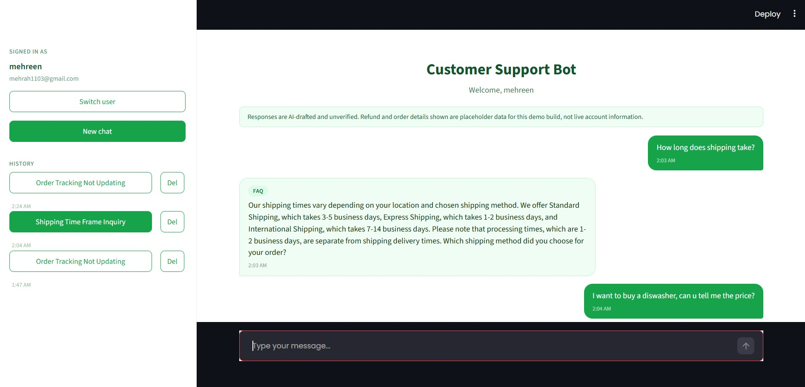

# Customer Support Agent

A customer support chatbot that classifies incoming queries, retrieves grounded answers from a local knowledge base, drafts replies, checks its own work, and pauses for human approval before high-value refunds go out. Built to demonstrate LangChain and LangGraph working together in a single, realistic pipeline.

Here is a preview of the application:


## Why this architecture

Most support automation demos either do plain RAG (retrieve, then answer, done) or plain agentic routing (classify, then respond, done). Real support workflows need both, plus the ability to loop and pause:

- Some questions are pure knowledge lookup (FAQ) → **retrieval-augmented generation**.
- Some require calling an external system (order status) → **tool use**.
- Some require caution before anything gets sent (refunds over a threshold) → **human-in-the-loop**.
- Every draft should be checked before it goes out, and reworked if it fails → **cyclic control flow**, not a straight line.

LangChain handles the first two. LangGraph handles the last two, and owns the overall sequencing.

## LangChain Usage

LangChain's job in this project is narrow and specific: turning raw documents into a queryable retriever, and providing a uniform interface to the LLM.

**Document ingestion and chunking.** `DirectoryLoader` reads every `.txt` file in `docs/`, and `RecursiveCharacterTextSplitter` breaks them into overlapping 500-character chunks. This runs once, at import time, not per query.

**Embedding and vector storage.** Each chunk is embedded with `FastEmbedEmbeddings` (ONNX-based, no PyTorch/GPU dependency) and stored in a local `Chroma` collection. `vectordb.as_retriever()` wraps this so a query string becomes a similarity search returning the top-k matching chunks.

**LCEL for the RAG chain.** The FAQ path is built with LangChain Expression Language:

```python
rag_prompt = ChatPromptTemplate.from_messages([...])
rag_chain = rag_prompt | llm
```

The `|` pipes a prompt template into the chat model — `rag_chain.invoke({...})` fills the template and returns the model's response in one call.

**Uniform LLM interface.** `ChatGroq` is the LangChain wrapper around Groq's API. Every node in the graph calls `llm.invoke([...])` the same way, regardless of what it's asking the model to do.

LangChain does not know a graph exists. It only sees function calls in, text out.

## LangGraph Usage

LangGraph owns everything LangChain doesn't: branching, looping, state, and pausing.

**State.** A single `TypedDict` (`State`) is threaded through every step — `query`, `history`, `category`, `draft`, `approved`, `refund_amount`, `retries`. Each node reads the current state and returns a partial update, which LangGraph merges back in.

**Routing.** `classify_node` labels the query as `faq`, `technical`, or `billing`. `route_query` reads that label and sends execution to the matching node — this is a **conditional edge**, not a hardcoded path.

**Cycles.** After a draft is produced, `qa_node` judges whether it actually answers the question. If not, `qa_router` sends it to `rewrite_node`, which improves the draft and loops back to `qa_node` again. This repeats until the draft passes or `MAX_RETRIES` is hit — LangGraph graphs are not required to be acyclic, which is what makes self-correction possible here.

**Human-in-the-loop.** If a billing reply involves a refund over $50, `qa_router` sends it to `human_review_node`, which calls `interrupt()`. This freezes the graph mid-execution and hands control back to the caller — no reply goes out until a human calls `Command(resume="approve")` (or `"reject"`).

**Persistence.** `SqliteSaver` checkpoints the graph's exact state after every node transition, keyed by `thread_id`. This is what makes the pause in `human_review_node` durable — the graph can resume hours later, even after an app restart, from exactly where it left off.

## The graph

```
classify → {faq | technical | billing}
              ↓
             qa ──(fail, retries left)──→ rewrite ──→ qa
              │
     (pass, refund > $50)          (pass, otherwise)
              ↓                            ↓
        human_review ──────────────────→ send
```

## Project structure

```
triage_agent.py    LangChain retrieval + LangGraph graph definition
ui.py               Streamlit chat interface
chat_store.py       SQLite storage for chat history and thread titles
requirements.txt
docs/               Your knowledge base (.txt files, chunked and embedded at startup)
.env                GROQ_API_KEY
```

## Setup

```bash
python -m venv venv
venv\Scripts\activate.bat        # Windows cmd
pip install -r requirements.txt
```

Create `.env`:

```
GROQ_API_KEY=your_key_here
```

Add plain-text knowledge base files to `docs/`.

Run:

```bash
streamlit run ui.py
```

## Known limitations

This is a demonstration build, not production-ready:

- `order_id` and `refund_amount` are hardcoded placeholders — a real deployment needs an actual order/CRM lookup.
- QA is self-judged by the same model that wrote the draft, with no independent rubric.
- Identity (name/email on the landing screen) is unverified and stored via URL query params — not real authentication. Swapping in real auth before handling real customer data is a required next step, not optional polish.
- No retry/backoff around the Groq API call; a failed request currently surfaces as an error rather than degrading gracefully.

## Tech stack

- **LLM**: Groq (`llama-3.3-70b-versatile`), free tier
- **Retrieval**: LangChain + Chroma + FastEmbed (no PyTorch dependency)
- **Orchestration**: LangGraph (`StateGraph`, conditional edges, `interrupt()`, `SqliteSaver`)
- **UI**: Streamlit
- **Storage**: SQLite (chat history + LangGraph checkpoints)
